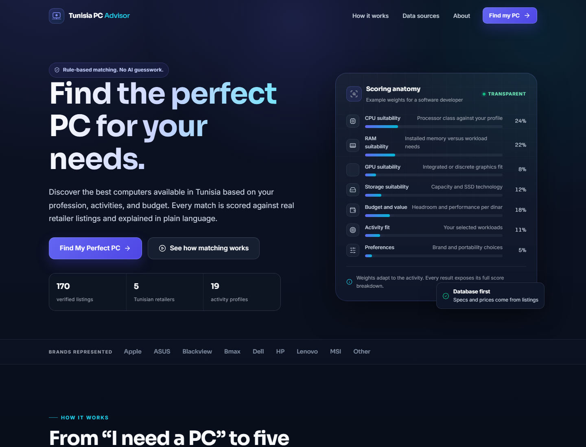

# Tunisia PC Advisor

A complete, deterministic PC recommendation platform for the Tunisian market. The user answers five questions about their work, workloads, device type, budget and preferences; a PHP/MySQL rule engine ranks up to five real retailer listings, explains each match, and links directly to the Tunisian product page.

**No AI APIs, no machine learning, no JavaScript framework and no fabricated catalogue rows.**



## What is included

| Area | Delivered |
|---|---|
| Public site | Homepage, five-step questionnaire, ranked results, product details, comparison, about, methodology, data sources and privacy pages |
| Recommendation engine | Hard budget/category/specification filters, activity profiles, workload scoring, adaptive weights, diversity pass, factual explanations and honest fewer-than-five handling |
| Catalogue | **170 distinct records** — 127 laptops and 43 desktops from **5 Tunisian retailers** — with direct product URLs, TND prices, stock labels, verification dates and 168 records that have a product-image URL |
| Admin | Protected login, dashboard, product CRUD/deactivation, retailer management, price/stock history, freshness buckets, broken-link queue and data-quality checks |
| Database | Normalised MySQL/MariaDB schema with foreign keys, indexes, checks, `DECIMAL` prices and append-only price history |
| Tools | Rate-limited Tunisia Net collector, manual verifier, image enricher, seed builder, link checker, session pruner, data-quality report generator and automated test runner |
| Documentation | Installation, database design, algorithm, testing report and data-quality report |

## Quick start (XAMPP)

1. Start **Apache** and **MySQL** from the XAMPP Control Panel.
2. Copy the project into `C:\xampp\htdocs\tunisia-pc-advisor` (or keep it where it is and configure a virtual host).
3. Import `database/schema.sql`, then `database/seed.sql` through phpMyAdmin. This creates `tunisia_pc_advisor` and loads the 170 listings.
4. Copy `.env.example` to `.env` and adjust `DB_HOST`, `DB_NAME`, `DB_USER` and `DB_PASS` if your XAMPP MySQL root account has a password.
5. Create an administrator from the project directory:

   ```bash
   C:\xampp\php\php.exe tools\create_admin.php --username=admin --name="Project Administrator"
   ```

   No administrator account is seeded. The command prompts for a password of at least 10 characters.
6. Open `http://localhost/tunisia-pc-advisor/` and sign in at `/admin/login.php`.

For a zero-configuration local preview without Apache:

```bash
C:\xampp\php\php.exe -S 127.0.0.1:8080 router.php
```

Then open `http://127.0.0.1:8080/`. The router blocks `.env`, SQL files, classes/config/tools and documentation from the built-in server. Apache uses the included `.htaccess` files instead.

Detailed setup, configuration and troubleshooting: [docs/LOCAL_SETUP.md](docs/LOCAL_SETUP.md). Virtual-host and maintenance notes: [docs/INSTALLATION.md](docs/INSTALLATION.md).

## Requirements

- PHP **8.2+** with `pdo_mysql`, `curl`, `mbstring`, `json` and `openssl` (the test environment used PHP 8.3.31 from XAMPP).
- MySQL **8+** or MariaDB **10.4+** (the test environment used MariaDB 10.4.32).
- Apache 2.4 with `AllowOverride All` for the included access rules, or the PHP built-in server with `router.php`.
- No Composer, Node.js, npm or framework installation is required.

## How the recommendation works

The questionnaire is validated on the server. The engine then:

1. Loads only active, purchasable products at or below the user's maximum budget. Out-of-stock products are excluded; limited/arriving products remain eligible and are labelled.
2. Applies hard filters: device category, explicit minimum RAM/storage and an explicitly required dedicated GPU.
3. Scores every survivor out of 100 using activity-specific weights for CPU, RAM, GPU, storage, budget/value, workload fit and preferences. The weights always total 100.
4. Sorts by compatibility, then performance-per-dinar, then lower price, and applies a small family/brand diversity pass so the final five are not five near-identical variants.
5. Generates each explanation from the stored processor, memory, storage, GPU, screen, retailer, price and verification date. Missing fields are omitted, never invented.

Every result exposes its full score breakdown in the interface. Over-budget products never silently enter a result set, and if fewer than five products qualify the page says so instead of filling the slots.

Full methodology: [docs/RECOMMENDATION_ALGORITHM.md](docs/RECOMMENDATION_ALGORITHM.md).

## Catalogue and research honesty

- **160 Tunisia Net records** were collected from public product sitemap/product pages on **10 November 2026** with a polite single-worker, rate-limited collector.
- **10 records from SpaceNet, SBS Informatique, Mytek and Wiki** were reviewed manually from their individual product pages.
- Every record has a direct product URL, a TND price, a verification timestamp and only documented specifications. Optional unknown fields are `NULL`.
- **Mytek and Wiki return HTTP 403 Cloudflare challenges** to automated rechecks. Their records are retained as manually reviewed evidence and marked `unchecked` for link health; no challenge was bypassed.
- **168 of 170 records have a product image.** The two missing images belong to the manually reviewed Mytek/Wiki records whose image metadata was not exposed to the checker.
- The investigated market did not provide a deep sub-1,200 TND segment. The catalogue includes only a small number of listings below that point. The engine never relaxes a budget to manufacture five results.
- Acer, Gigabyte and Samsung rows are not present in the final selected set; they were not invented to fill brand quotas.

Read the generated [data quality report](database/data_quality_report.md) for counts, limitations and the verification evidence.

## Project structure

```text
.
├── index.php                     Homepage
├── questionnaire.php             Five-step form
├── actions/
│   └── generate_recommendations.php
├── results.php                   Ranked matches
├── product.php                   Full product detail
├── compare.php                   Up to three products side by side
├── how-it-works.php              Methodology page
├── data-sources.php              Sources and limitations
├── about.php / privacy.php
├── bootstrap.php                 Config, autoload and security headers
├── router.php                    Safe router for PHP's built-in server
├── config/                       App and database configuration
├── classes/                      Repositories, validation, engine, explanations
├── includes/                     Header, footer, helpers and mini card
├── admin/                        Protected administration area
├── assets/                       CSS, vanilla JS, Lucide UMD and local SVGs
├── database/
│   ├── schema.sql                Complete schema
│   ├── seed.sql                  Generated catalogue seed
│   ├── seed_base.sql             Activities, requirements, workloads, brands, retailers
│   ├── data_quality_report.md
│   └── research/                 Collector output and manual verification evidence
├── docs/
│   ├── LOCAL_SETUP.md
│   ├── INSTALLATION.md
│   ├── DATABASE.md
│   ├── RECOMMENDATION_ALGORITHM.md
│   ├── TESTING.md
│   └── screenshots/
└── tools/                        CLI research, maintenance and test tools
```

## Administration

The admin area is protected by password hashing (`password_hash`/`password_verify`), session regeneration, CSRF tokens on every mutating form, login throttling and a two-hour inactivity timeout.

- Dashboard: catalogue counts, average listed price, stock, freshness, broken links, recent edits.
- Products: search and filter by brand, retailer, category, price, stock, link status and freshness; add/edit records; deactivate without destroying history; inspect price history.
- Retailers: add/edit/activate/deactivate with slug and domain validation.
- Data quality: duplicate URLs/SKUs, missing critical fields, invalid/homepage URLs, price range, freshness and broken-link queue.
- Account: change the administrator password.

There is no public registration and no hard-coded default password.

## Testing

The automated CLI suite currently reports:

```text
168 passed, 0 failed.
```

It covers schema integrity, foreign keys, duplicate detection, price-history append behaviour, hard filters, all eight required recommendation scenarios, score arithmetic, purchase-link domains, explanation facts, questionnaire validation, SQL-injection handling, XSS escaping, CSRF, password hashing and session-cookie settings. The HTTP flow was also exercised with real sessions under PHP's built-in server and under Apache 2.4, including 404 invalid tokens, 419 missing CSRF, 3-result and 0-result scenarios, admin login/logout, unauthorized redirects, add/edit/deactivate, price-history writes and `.htaccess` denial checks.

See [docs/TESTING.md](docs/TESTING.md) for the complete test matrix, scenario results and known limitations.

## Screenshots

| Desktop | Mobile |
|---|---|
| [Homepage](docs/screenshots/01-home.png) | [Homepage](docs/screenshots/12-mobile-home.png) |
| [Questionnaire](docs/screenshots/02-questionnaire.png) | [Questionnaire](docs/screenshots/14-mobile-questionnaire.png) |
| [Results](docs/screenshots/03-results.png) | [Results](docs/screenshots/13-mobile-results.png) |
| [Comparison](docs/screenshots/04-compare.png) | |
| [Product detail](docs/screenshots/05-product.png) | |
| [Admin login](docs/screenshots/10-admin-login.png) | |
| [Admin dashboard](docs/screenshots/11-admin-dashboard.png) | |

## Documentation

- [Local setup and configuration](docs/LOCAL_SETUP.md)
- [Installation and XAMPP setup](docs/INSTALLATION.md)
- [Database design and maintenance](docs/DATABASE.md)
- [Recommendation algorithm](docs/RECOMMENDATION_ALGORITHM.md)
- [Testing report](docs/TESTING.md)
- [Data quality report](database/data_quality_report.md)

## Academic scope and limitations

This is an academic project, not a live shopping service. Prices and stock are verification-time snapshots, not real-time feeds. Hardware tiers are transparent rule-based heuristics, not benchmark measurements. The catalogue cannot guarantee current retailer availability, and some optional fields (weight, battery, panel type) are absent where the source page did not document them. The interface and reports deliberately say so rather than guessing.

No affiliate links, sponsored placement or external recommendation API is used.
